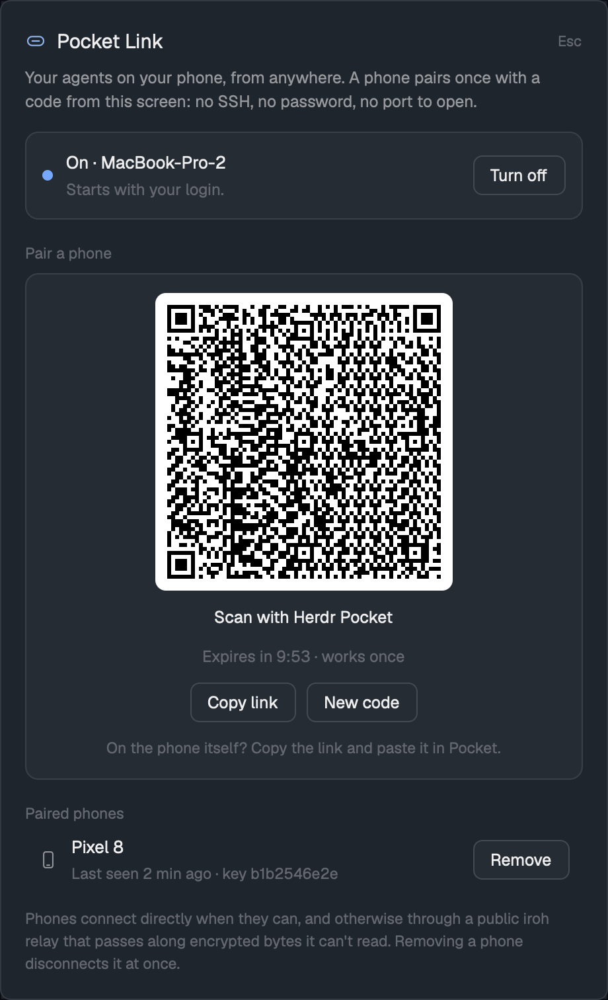

# Pocket Link

A small dialog that pairs a phone with this computer the way a TV pairs with a
streaming account. You turn it on and press **Pair a phone**. A QR code
appears. You scan it with the Herdr Pocket Android app, and from then on the
phone reaches this machine's terminals and agents from anywhere. There is no
SSH, no password and no port to open. A small Node bridge answers the phone
over [iroh](https://iroh.computer). Connections are end to end encrypted and
direct when possible, or go through a relay that can't read them. The bridge
hands each paired phone a herdr-core session. The dialog also lists paired
phones, so you can remove one, and that disconnects it at once.

## What you see

The dialog is 460px wide, from `mod.json` `{ "kind": "dialog", "width": 460 }`, with 18px padding on the theme's `popover` background. From top to bottom:

1. **Title row:**
   - a 16px link icon in `accent`
   - "Pocket Link" in 15px semibold
   - "Esc" in 11px `dim`, on the right
2. **Intro:** one line in 12.3px/18px `muted`: "Your agents on your phone, from anywhere. A phone pairs once with a code from this screen: no SSH, no password, no port to open."
3. **Power card:** 14px above it, 12px padding, 10px radius, a 1px `border`, on `raised`.
   - An 8px dot: `done` when on, `dim` when off.
   - A two-line label, 13px semibold over 12px `dim`:
     - On, with the service: "On · <host name>" over "Starts with your login."
     - On, without the service: "Running until you log out."
     - Off: "Off" over "Phones can't reach this computer."
   - On the right, a button: **Turn off** (outlined), or **Turn on** (solid, primary).
4. **"Pair a phone"** section, shown only while it's on. The section title is 11.5px medium `dim` with 16px above and 6px below.
   - With no code: one `muted` note and a primary **Pair a phone** button. The note reads "Open Herdr Pocket on the phone, tap Pair with Herdr desktop, and scan the code this makes. The code works once, for 10 minutes."
   - With a code, a `raised` card (14px padding, 10px radius) holds, centred:
     - The QR code: black modules on a white card with an 8px radius and a 3-module quiet zone. Each module is `floor(224 / modules)` px, which is 3px for the usual 73 modules, so about 237px square.
     - "Scan with Herdr Pocket" in 12.5px.
     - "Expires in 9:41 · works once" in 12px `dim`, counting down every second.
     - Two outlined buttons: **Copy link** (reads "Copied" after a click) and **New code**.
     - "On the phone itself? Copy the link and paste it in Pocket." in 11.5px `dim`.
5. **Phones:** the section title is "Paired phones", or "No phones paired yet". Each phone is a row, 40px tall with a 10px side padding and an 8px radius, that turns `hover` under the pointer. The row has:
   - a 15px phone icon in `muted`
   - the phone's name in 13px, truncated
   - "Last seen 3 min ago · key 4f1c9a07de" in 11.5px `dim`
   - an outlined **Remove** button
6. **Errors:** when there is one, it shows in 12px `blocked`.
7. **Footer:** in 11.5px/17px `dim`: "Phones connect directly when they can, and otherwise through a public iroh relay that passes along encrypted bytes it can't read. Removing a phone disconnects it at once."

Buttons are 30px tall with 12px side padding, a 7px radius and 12.5px medium text.
- **Primary:** `solid` with `solid_foreground` text.
- **Outlined:** `raised` with a 1px `input` border, turning `hover` on hover.
- **Disabled:** 45% opacity.
- **Busy:** the label changes ("Turning on…", "Making a code…") and a 12px spinner turns once every 900ms.

Before the bridge can run, the dialog shows one of two other screens in place of items 3–5:
- **No Node.js 20.3+ on PATH:** a note says how to get it.
- **Packages not installed:** a note and a primary **Install the bridge** button.

## How it behaves

- **Opening:** it asks the bridge for its status and draws it.
- **Live updates:** it then watches the mod's `.state/` folder and redraws whenever the bridge writes something there (pairing, phones, its address). Nothing polls.
- **Turn on:**
  1. It installs a login service:
     - **macOS:** a LaunchAgent `dev.herdr.pocket-link` with `KeepAlive`, bootstrapped into `gui/<uid>`
     - **Linux:** a systemd user unit `herdr-pocket-link.service`, enabled with `--now`
  2. The service starts the bridge now and at every login.
  3. If the bridge isn't running 4s later, the dialog starts a detached one instead, which lives until logout.
- **Turn off:** removes the service, stops the bridge, and cancels any open code.
- **Pair a phone:**
  - The bridge makes a one-time code: 16 random bytes, base64url, valid for 10 minutes.
  - The dialog draws the QR of `herdr-pocket://pair?v=1&n=<host>&c=<code>&t=<iroh endpoint ticket>`.
  - **New code** replaces the old code, so the old one stops working.
  - At 0:00 the card goes back to the button.
- **When a phone pairs** with the code:
  - The bridge stores the phone's iroh public key and deletes the code.
  - The dialog posts a "Phone paired" toast (`notify`, success, 6s), puts the card away, and lists the phone.
  - Pairing again from a phone that's already listed refreshes its entry and also shows the toast.
- **Remove:** forgets the phone. The running bridge checks its list every 2s and closes that phone's open sessions with "not paired". On the phone, Pocket says to pair again.
- **Wrong codes:** five wrong codes in a row end the code, and a used or expired code is refused, so guessing gets nowhere.
- **Esc** closes the dialog. **⌘⌥P** on macOS, or **Ctrl+Alt+P** on Linux, opens it (see `keys.json`).
- **Phone sessions:**
  - Each phone session opens a bidirectional QUIC stream on ALPN `herdr-pocket/1`.
  - Its first line is a JSON header `{"session":"<herdr-core session>"}`; names must match `[A-Za-z0-9_.-]{1,64}`, or `default` is used.
  - The rest of the stream is piped to and from `hc connect` with `HC_SESSION` set, so the phone speaks herdr-core's own protocol.
  - The bridge refuses any key that isn't paired.

## Built from

- **`mods/pocket-link/mod.json`:** `{ "place": "none", "title": "Pocket Link", "overlay": { "kind": "dialog", "width": 460 } }`.
- **`mods/pocket-link/main.js`:** one `View`.
  - **Imports:**
    - `div` and `svg` from `gpui-kit`
    - `v_flex` and `h_flex` from `gpui-base`
    - `exec`, `appHome`, `theme`, `props`, `closeOverlay`, `notify` and `watchFolder` from `herdr`
  - **Calling the bridge:** it runs `exec("node", ["<appHome>/mods/pocket-link/bridge/bridge.mjs", <command>, …])` and parses the last stdout line as JSON. The commands are `status`, `install`, `start`, `stop`, `pair` and `forget <id>`.
  - **Clipboard:** `cx.write_to_clipboard`.
  - **Timers:** a 1s `cx.timer.every` runs only while a code shows.
  - **Install the bridge:** runs `npm ci --omit=dev` in `bridge/`. It is detached so it can run past `exec`'s 30s limit, and the dialog watches for `.setup.done`.
  - **The QR:** drawn as divs, one `h_flex` per module row, with runs of dark modules merged into one div.
- **`mods/pocket-link/icons/`:** its own `link.svg`, `phone.svg`, `spinner.svg` and `x.svg`. These are 24×24 strokes on `currentColor`, used with `svg()` so they take the text colour.
- **`mods/pocket-link/bridge/`:**
  - `package.json` depends on exact versions: `@number0/iroh` 1.2.0 and `qrcode` 1.5.4. `package-lock.json` is included.
  - **`bridge.mjs`** commands:
    - `serve`
    - `pair [minutes]` prints `{link, expires, rows}`, where `rows` holds the QR modules as strings of `1`/`0`
    - `status` prints `{running, id, name, ticket, devices, pairing, login}`
    - `start`, `stop`, `forget <id>`, `install` and `uninstall`
  - **Serving:**
    1. It binds an iroh `Endpoint` with the n0 preset, a persistent secret key and two ALPNs: `herdr-pocket/1` and `herdr-pocket/pair/1`.
    2. It writes its ticket (`EndpointTicket.fromAddr(ep.addr())`) to `status.json`, and again whenever its address changes.
    3. It accepts connections: pair requests check the code, and sessions are piped to `hc connect`.
  - **Finding `hc`:** `$HC`, then `command -v hc` in a login shell, then `~/.local/bin`, `/opt/homebrew/bin` and `/usr/local/bin`.
- **`mods/pocket-link/.state/`** (hidden, so writing it doesn't reload the mod), all files mode 0600 and written atomically:
  - `secret.key`
  - `status.json`
  - `devices.json`
  - `pairing.json`
  - `bridge.log`
- **The phone side:** [herdr-pocket](https://github.com/namastex888/herdr-pocket), with `computer.iroh:iroh-android:1.2.0`. It opens the `herdr-pocket://pair` link from a scan, a paste or a tapped link, asks before pairing, and keeps its own key in no-backup storage.
- **What it touches on the computer:**
  - **Network:** iroh's n0 preset. It keeps a connection to n0's public relays and publishes the bridge's public key and current addresses to n0's address lookup, so phones find it after an IP change. Phones connect in over QUIC/UDP.
  - **Programs:** `node`, `npm` (setup only), `hc connect`, `launchctl` or `systemctl --user`, and `sh` (to find `hc` and run setup).
  - **Files outside the folder:** only the login service file, `~/Library/LaunchAgents/dev.herdr.pocket-link.plist` or `~/.config/systemd/user/herdr-pocket-link.service`.

## Watch out

- **`image()` won't show a file from the hidden `.state/` folder.** Drawing the QR from its modules avoids that, and also avoids image caching when a new code is made. A QR file in a visible folder would reload the mod on every code.
- **`exec` stops a program after 30s**, so `serve` can't run under it. The bridge has to run as a login service or detached (`start`), and npm setup also has to run detached.
- **`launchctl bootstrap` right after `bootout` fails** with "Input/output error" while launchd is still unloading the old job. Retry it for a few seconds.
- **The Homebrew Cellar path breaks:** `process.execPath` under Homebrew is a versioned Cellar path that disappears on upgrade. Write the `opt/<formula>/bin/node` link into the service.
- **Log lines appear twice:** under launchd, stderr already is `bridge.log`. Append to the file yourself only when stderr is a terminal.
- **A phone removed mid-session would come back:** it can be re-added by a session that read `devices.json` earlier. Read the file again just before updating a phone's "seen" time.
- **The pairing link is a capability:** anyone holding the link (or the QR) within its 10 minutes can pair, because the code is the secret. Don't screenshot a live one. This preview's QR encodes a made-up link.
- **The phone's code must match:**
  - The phone accepts only `v=1`, `t` matching `^endpoint[a-z2-7]{20,2000}$` and `c` matching `^[A-Za-z0-9_-]{16,64}$`.
  - Names are cut to 60 characters with control characters removed.
- **Requirements:**
  - Node 20.3+ on PATH in the user's environment.
  - herdr-core's `hc` installed.
  - macOS or Linux with systemd; Windows isn't handled.
- **Phones see every herdr-core session**, the same way a terminal running `hc` does. Pair only your own phones.

## Done when

- `herdr-app check mods/pocket-link` passes, and `mod.open pocket-link` (or ⌘⌥P) opens the dialog, which shows "Off" or "On · <host>".
- **Turn on:** `node bridge/bridge.mjs status` reports `"running":true,"login":true`, and on macOS `launchctl print gui/$(id -u)/dev.herdr.pocket-link` shows `state = running`.
- **Pair a phone:**
  - A QR appears and decodes, with any QR reader, to the same link `bridge.mjs pair` printed.
  - Its `c=` equals the code in `.state/pairing.json`.
  - The countdown falls each second.
- **Pairing with Herdr Pocket** (scan, or `adb shell am start -a android.intent.action.VIEW -d '<link>'`):
  - The phone shows "Pair with <host>?". Pair connects it and lists the agents.
  - The dialog shows a "Phone paired" toast and lists the phone.
  - `bridge.log` reads `pair: added …` then `session: …`.
- **Reusing a code** is refused with "This pairing code was already used or has expired…", and a wrong code with "That code is not the one on the desktop."
- **Remove:** the phone's open session ends within about 2s, and `bridge.log` reads "session: ended for a removed phone". Its next connection is refused with "not paired".
- **Turn off** removes the service file, stops the bridge, and the dialog shows "Off".
